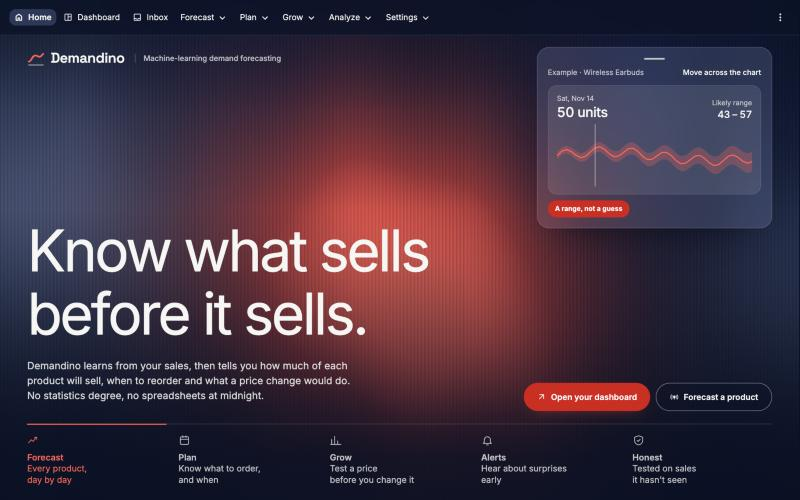
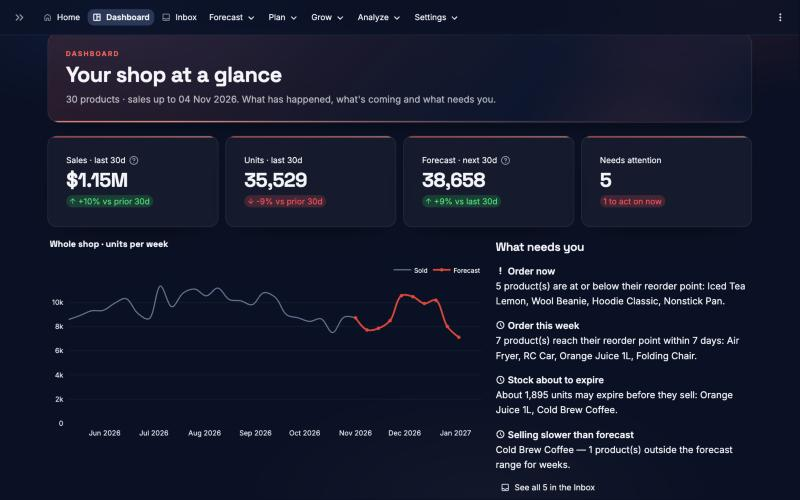
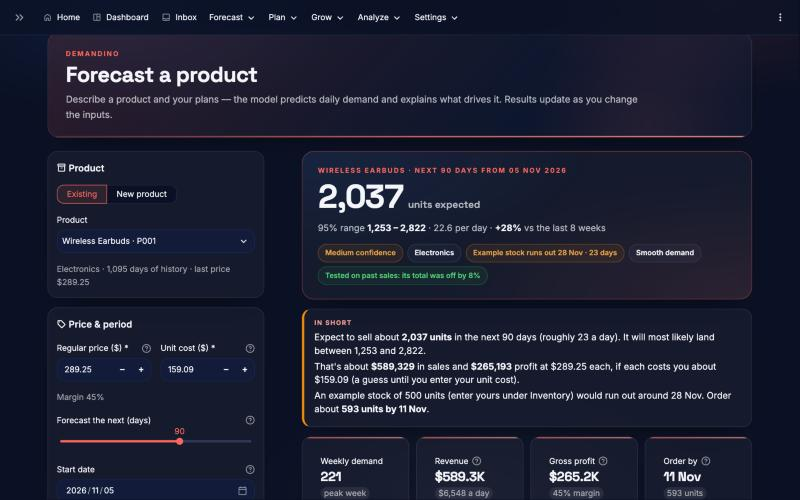

# Demandino

**Know what sells before it sells.** Demandino is a demand forecasting and inventory planning app for small shops. It
learns from your sales history, then shows how much of each product will sell, when to reorder and what a price
change or promotion would do.


[](LICENSE)
[](https://github.com/WillBettleheim/Demandino/actions/workflows/checks.yml)



| Your shop at a glance | One product's forecast |
|---|---|
|  |  |

## What kind of project is this?

| | |
|---|---|
| **Type** | Web app for sales forecasting and stock planning |
| **For** | Small shops and online sellers with daily sales data |
| **Method** | Gradient-boosted trees (scikit-learn) with prediction ranges calibrated on sales the model hasn't seen |
| **Built with** | Python, Streamlit, pandas, scikit-learn, Plotly, SQLite |
| **Status** | Working demo. Not yet tested with real shops or hosted for public use |

## What it does

**Forecast**
- Daily forecasts for each product, up to 180 days ahead, with a likely range rather than one number
- Estimates for new products from their category, price or a similar product
- Learns weekdays, seasons, holidays, prices and promotions, and corrects for stock-outs and one-off bulk orders
- Alerts when a product sells faster or slower than expected, with the reason each forecast moved

**Plan**
- Order quantities and reorder dates for the whole shop, within a budget
- Purchase orders, real supplier delivery times, stock transfers and shelf-life limits
- Monthly buying budget, and markdowns to clear slow stock

**Grow**
- Test a price change or sale on one product or the whole shop before you make it
- Sales targets with the chance of reaching them and what would close the gap
- Products often bought together, and the money lost to stock-outs

**Manage**
- A dashboard and an inbox of what needs attention, most urgent first
- Upload a CSV or connect Google Sheets, Shopify, WooCommerce or Amazon reports
- Check uploads for problems, and edit or remove products without changing your data
- Excel and PDF reports, share links, and alerts by Slack or email
- An optional AI assistant (Claude) that answers questions about a forecast

## Quick start

You need Python 3.14.

```bash
git clone https://github.com/WillBettleheim/Demandino.git
cd Demandino
python3 -m venv .venv
.venv/bin/pip install -r requirements.txt
.venv/bin/streamlit run app.py
```

It opens at http://localhost:8501 with a sample shop of 30 products, so you can try everything without any data of your
own. The first forecast trains the model, which can take a minute. After that it's quick.

Optional settings are listed in [`.env.example`](.env.example). Keep real keys out of the code.

## Using your own data

In the sidebar, choose **Data → My CSV**. Use one row per product per day:

| Column | Required | Notes |
|---|---|---|
| `date` | Yes | Also reads names like `Order Date`. Day-first and month-first dates both work |
| `product_id` | Yes | Also reads `SKU`, `Item` and similar, or the product name |
| `units_sold` | Yes | Also reads `Quantity`, `Qty Sold` and similar |
| `price` | Yes | Also reads `Unit Price` and similar. Values like `$1,010.00` are fine |
| `product_name`, `category` | No | Make results easier to read and forecasts better |
| `regular_price`, `promo` | No | Worked out from the price if missing |
| `on_hand` | No | Stock on hand, which helps spot stock-outs |

Two years of history is ideal. A product needs at least 114 days: 86 to learn from and 28 to test on.

## How accurate is it?

Each figure comes from forecasts of sales the model never saw, averaged over several test periods. It shows how far the
forecast was from what really sold, as a share of what sold.

| What's being forecast | Real store | Simulated shop |
|---|---|---|
| Whole shop, per month | 9.3% | 2.9% |
| One category, per month | 12.4% | 5.5% |
| Whole shop, per week | 19.6% | 6.7% |
| One product, 90-day total | 21.4% | 7.9% |
| One product, per month | 28.9% | 10.3% |
| One product, per week | 46.8% | 17.4% |
| One product, per day | 83.3% | 37.4% |

The real store is a UK gift wholesaler whose sales come in irregular bursts, which makes single products hard to predict.
In the 90-day test on this data, the model was closer than a recent-average forecast (44% against 48% weekly), and real
daily sales landed inside the likely range about 95% of the time. Plan by the week or month where you can. The **Model
accuracy** page runs the same test on your own data.

## Security

Passwords are hashed, saved keys are encrypted, and uploads, outgoing requests and account storage are all limited. Tests
try the attacks that matter, and these checks run on every push:

```bash
.venv/bin/python scripts/security_check.py --history --deps
```

Read [SECURITY.md](SECURITY.md) before you deploy it. It covers what's protected, the known limits and what the server
needs. Back up the database with `scripts/backup.py`.

## Project layout

```text
app.py          Starts the app and defines the menu
views/          One file per page
demandino/      Forecasting model, planning, accounts, connectors and security
scripts/        Security check, backups, digests and data preparation
tests/          Test suite
data/           Real store sales used for testing
```

Run the tests with:

```bash
.venv/bin/pip install pytest
.venv/bin/python -m pytest -q
```

## Data

The real store data comes from [UCI Online Retail II](https://archive.ics.uci.edu/dataset/502/online+retail+ii)
(CC BY 4.0). The sample shop is simulated.

## License

The code is released under the [MIT License](LICENSE). The real store data in `data/` keeps its own
license, CC BY 4.0.

## Disclaimer

Forecasts are estimates to support your decisions, not guarantees.
